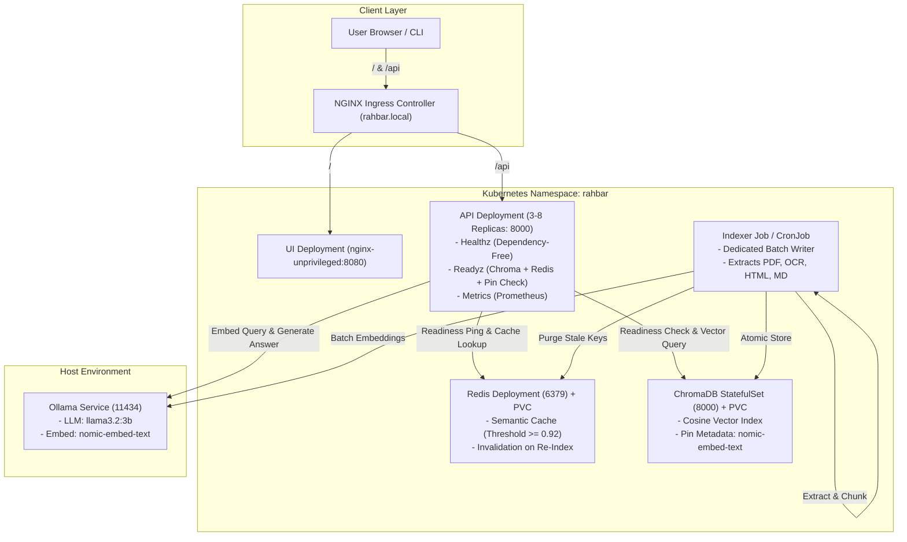

# RAHBAR — Grounded RAG on Kubernetes


RAHBAR is a production-grade, grounded question-answering service that answers queries strictly from an official FAST-NUCES university document corpus, cites its sources, adheres to strict JSON schemas, and runs on a resilient Kubernetes cluster. When the corpus lacks the answer, the service honestly abstains rather than hallucinating.

---

## 1. Problem Statement & Architecture

Language models exhibit fluency without factuality: when asked about university regulations, general-purpose models sound convincing while citing non-existent policies or rules from other institutions. RAHBAR bridges this gap by decoupling document ingestion from request serving. An offline **indexer Job** extracts, cleans, chunks, embeds, and stores documents in ChromaDB. The **API deployment** (3 replicas, autoscale up to 8) reads the index, verifies embedding model compatibility, checks a semantic Redis cache, queries ChromaDB, constructs an augmented prompt with untrusted data delimiters (`<evidence>`), validates model generation with Pydantic, filters citations against retrieved chunks, and abstains when evidence falls below the relevance floor.

### System Architecture Diagram



---

## 2. Cluster Setup and Clean-Clone Instructions

Follow these instructions to run the entire system from a fresh clone:

### Step 1: Start Minikube Cluster
Start Minikube with the Calico CNI plugin (mandatory for NetworkPolicy enforcement) and enable required addons:
```bash
minikube start --driver=docker --cpus=4 --memory=8192 --cni=calico
minikube addons enable metrics-server
minikube addons enable ingress
```

### Step 2: Start Ollama on Host
Run Ollama bound to `0.0.0.0` so cluster containers can reach it at `host.minikube.internal:11434`:
```bash
OLLAMA_HOST=0.0.0.0 ollama serve
ollama pull llama3.2:3b
ollama pull nomic-embed-text
```

### Step 3: Fetch the Official Corpus
Download the 9 verified university documents and generate `corpus/MANIFEST.md`:
```bash
python corpus/fetch.py
python corpus/fetch.py --verify
```

### Step 4: Build Container Images and Load into Minikube
```bash
docker build -t rahbar-api:dev api
docker build -t rahbar-indexer:dev indexer
docker build -t rahbar-ui:dev ui
minikube image load rahbar-api:dev
minikube image load rahbar-indexer:dev
minikube image load rahbar-ui:dev
```

### Step 5: Exact Kubernetes Apply Order
Deploy all Kubernetes resources in order using Kustomize:
```bash
# 1. Apply dev overlay (Namespace, ConfigMap, Secrets, PVCs, StatefulSet, Deployments, NetworkPolicies)
kubectl apply -k k8s/overlays/dev

# 2. Wait for dependencies to roll out
kubectl rollout status statefulset/chroma -n rahbar --timeout=120s
kubectl rollout status deployment/redis -n rahbar --timeout=120s

# 3. Execute the initial Indexer Job
kubectl wait --for=condition=complete job/indexer -n rahbar --timeout=300s

# 4. Wait for API and UI rollouts
kubectl rollout status deployment/api -n rahbar --timeout=180s
kubectl rollout status deployment/ui -n rahbar --timeout=120s
```

---

## 3. How to Run and Trigger Ingestion
Indexing runs strictly in an isolated Job, never on API startup:
- **Initial Indexing:** Automatically executed via `k8s/base/indexer-job.yaml` during initial deployment.
- **Scheduled Ingestion:** Runs every Sunday at 3:00 AM PKT via `k8s/base/reindex-cronjob.yaml`.
- **Manual Ingestion On-Demand:** Trigger an immediate re-index without restarting the API:
  ```bash
  kubectl create job --from=cronjob/reindex manual-reindex-1 -n rahbar
  kubectl logs -l job-name=manual-reindex-1 -n rahbar -f
  ```

---

## 4. API Endpoints Table

| Method | Path | Purpose | Behavior & Dependencies |
|---|---|---|---|
| GET | `/healthz` | K8s Startup & Liveness Probe | Completely dependency-free. Returns `{"status": "alive"}` with HTTP 200. Never touches Chroma, Redis, or LLM. |
| GET | `/readyz` | K8s Readiness Probe | Validates all dependencies: ChromaDB heartbeat, collection existence, non-empty chunk count, Redis reachability, and embedding-pin model match. Returns HTTP 503 if any check fails. |
| GET | `/metrics` | Prometheus Metrics | Exposes `rahbar_requests_total`, request latency histograms, and cache hit counters in standard Prometheus text format. |
| POST | `/api/ask` | Grounded Q&A | Accepts `{"question": "..."}` (`3-500` chars). Returns structured `AskResponse` with citations, confidence, retrieved refs, and request tracing ID. |

---

## 5. Evaluation and Verification

To score the running system against the 16-question golden evaluation dataset:
```bash
# Local evaluation
python eval/run_eval.py --api http://localhost:8000 --golden eval/golden.yaml --baseline eval/baseline.json

# Via Ingress on Minikube
python eval/run_eval.py --api http://$(minikube ip) --host rahbar.local --golden eval/golden.yaml
```

The CI gate enforces three non-negotiable quality criteria:
1. **Recall@5 Regression:** Must not drop more than 0.05 (5 percentage points) below baseline.
2. **Citation Validity:** Must be >= 95.0%.
3. **Must-Abstain Correctness:** Must be 100.0%.
