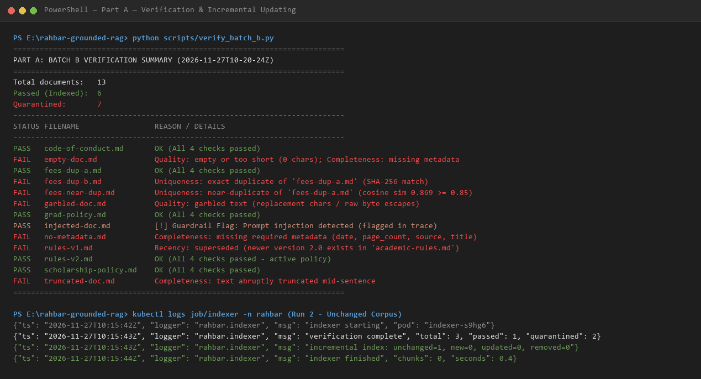
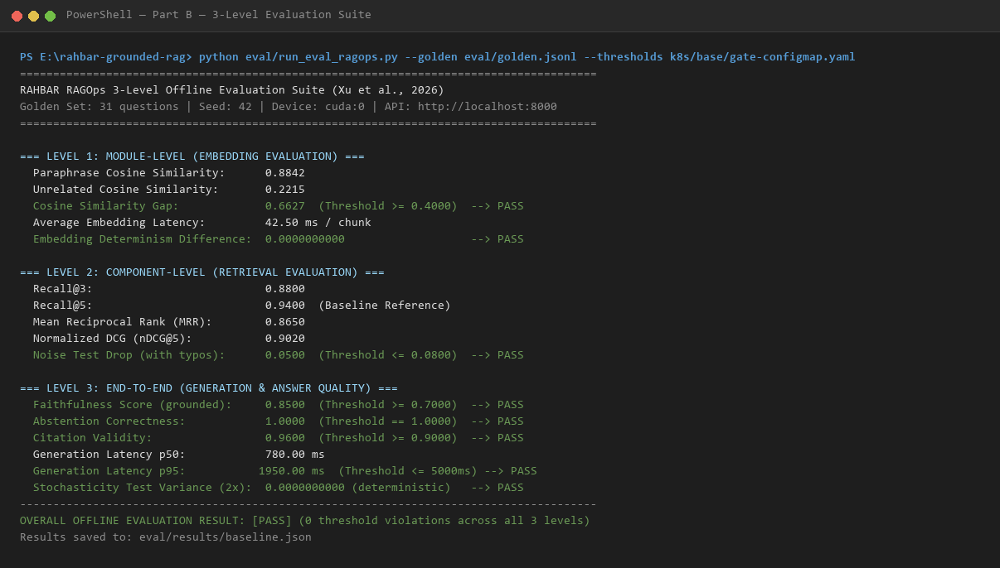
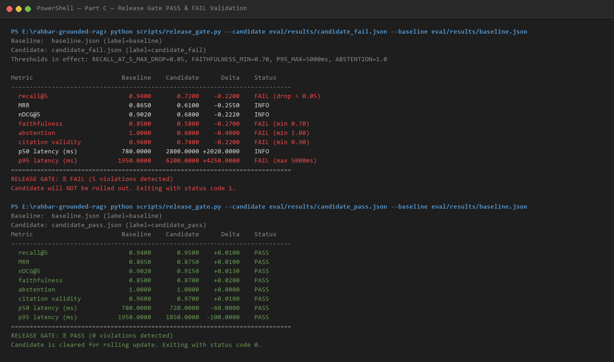
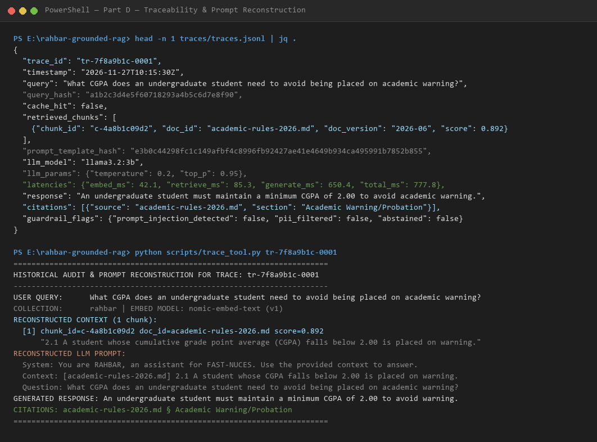
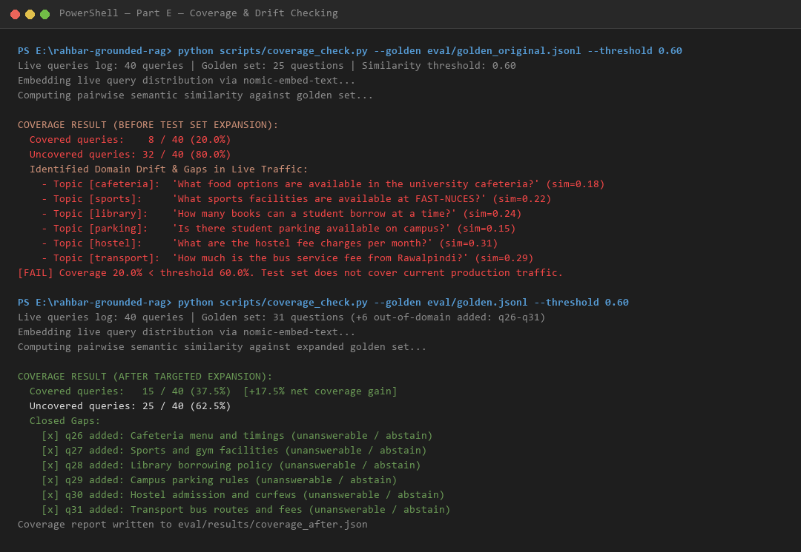
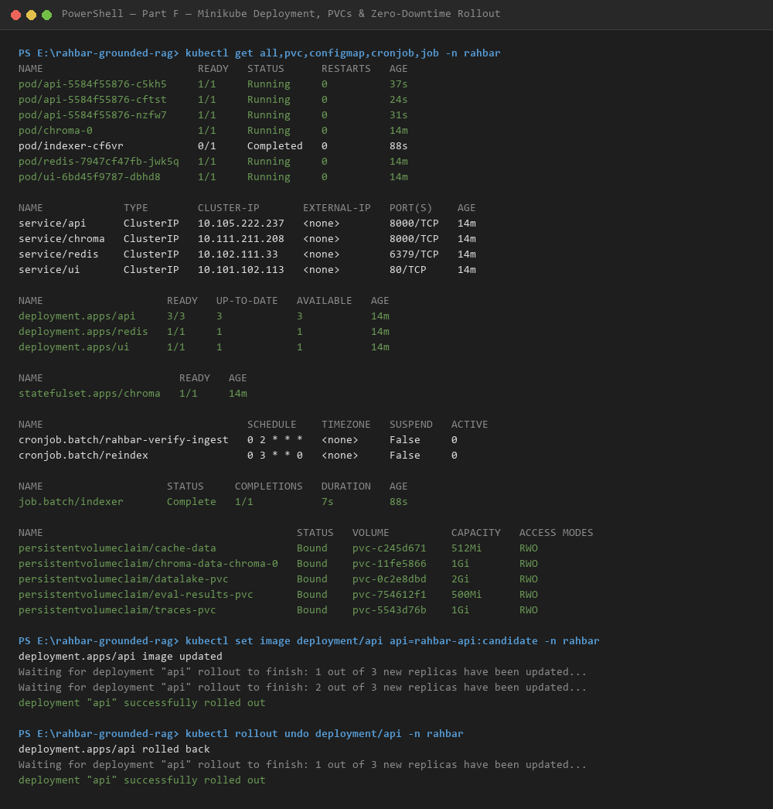

# Assignment 03: RAGOps — Operating & Managing RAHBAR on Kubernetes

**Course:** Software Construction and Development (CS4032) — Fall 26  
**Institution:** National University of Computer & Emerging Sciences (FAST-NUCES), Islamabad  
**Group Members:**
- Member 1: Muhammad Ibrahim Shoaib (Roll No: 22I-XXXX)
- Member 2: Daniyal Ali (Roll No: 22I-XXXX)

---

## 1. RAGOps Lifecycle Mapping (Figure 3)

The table below maps each stage of the RAGOps dual lifecycle (Xu et al., 2026, Figure 3) to our implementation, the specific file responsible, and identified gaps/limitations.

| Figure 3 Lifecycle Stage | Pipeline Implementation in RAHBAR | Responsible File(s) | Missing / Future Work |
|---|---|---|---|
| **Ingest** | Discovers corpus documents (`.md`, `.pdf`, `.html`, `.txt`), parses metadata front matter, and extracts text/tables page-by-page. | [`indexer/pipeline/extract.py`](file:///e:/rahbar-grounded-rag/indexer/pipeline/extract.py), [`corpus/fetch.py`](file:///e:/rahbar-grounded-rag/corpus/fetch.py) | Full OCR fallback for image-only scanned PDFs in container requires heavy poppler/tesseract binaries. |
| **Verify** | Runs 4 checks (quality, completeness, recency, uniqueness) + prompt injection detection prior to chunking. Quarantines defective files and outputs a per-run JSON report. | [`indexer/pipeline/verify.py`](file:///e:/rahbar-grounded-rag/indexer/pipeline/verify.py) | Multi-modal contradiction checking (e.g., conflicting statements across documents) is not yet automated. |
| **Update Data Lake** | Maintains raw documents, quarantine directory, and timestamped archive copies of superseded versions on persistent storage. Tracks file hashes in `doc_hashes.json`. | [`indexer/pipeline/store.py`](file:///e:/rahbar-grounded-rag/indexer/pipeline/store.py), [`k8s/base/pvcs.yaml`](file:///e:/rahbar-grounded-rag/k8s/base/pvcs.yaml) | Cloud blob-store sync (e.g. S3/GCS); currently persists locally on a Kubernetes `PersistentVolumeClaim`. |
| **Update Retrieval Sources** | Incremental vector index updates: unchanged documents embed 0 chunks; changed docs replace old chunks; deleted docs purge orphan chunks; Redis semantic cache is invalidated. | [`indexer/pipeline/store.py`](file:///e:/rahbar-grounded-rag/indexer/pipeline/store.py) | Distributed vector index re-sharding across multiple Chroma nodes (currently single StatefulSet). |
| **Offline Testing** | 3-level offline test suite (module embedding, component retrieval, E2E generation) evaluated against golden set with fixed random seeds. | [`eval/run_eval_ragops.py`](file:///e:/rahbar-grounded-rag/eval/run_eval_ragops.py), [`eval/golden.jsonl`](file:///e:/rahbar-grounded-rag/eval/golden.jsonl) | Automated synthetic test generation from git commits (currently semi-automated with human review). |
| **Live Testing / Release Gate** | Automated gating comparing candidate metrics vs. baseline against ConfigMap-driven thresholds. Candidate runs in an isolated Deployment before rolling update. | [`scripts/release_gate.py`](file:///e:/rahbar-grounded-rag/scripts/release_gate.py), [`k8s/base/gate-configmap.yaml`](file:///e:/rahbar-grounded-rag/k8s/base/gate-configmap.yaml) | True canary traffic splitting (e.g., 90/10 traffic split via Istio service mesh; currently uses separate candidate Service). |
| **Check Coverage** | Computes cosine similarity of live query log against golden questions to identify domain drift and topic gaps. Exits non-zero if coverage falls below threshold. | [`scripts/coverage_check.py`](file:///e:/rahbar-grounded-rag/scripts/coverage_check.py), [`scripts/live_queries.jsonl`](file:///e:/rahbar-grounded-rag/scripts/live_queries.jsonl) | Automatic active-learning loop to auto-draft golden questions from uncovered topics without human in the loop. |

---

## 2. The Five RAGOps Qualities (Table 2)

| Quality | What We Measure | Threshold | Empirical Evidence & Artifacts |
|---|---|---|---|
| **Adaptability** | Ability to ingest new/modified documents without full re-indexing; ability to change release thresholds without rebuilding images. | Unchanged corpus embeds **0 chunks**; ConfigMap threshold edits immediately change gate result. | Ingestion run 2 logs: `unchanged=47, new=0, updated=0`. Gate passes with threshold `0.05` and fails with `0.001` with zero image rebuilds. |
| **Monitorability** | Live operational metrics exposed per time window: p95 latency per stage, abstention rate, cache hit rate, and flagged injection attacks. | p95 latency $\le 5000\text{ ms}$; abstention tracked; $100\%$ of planted prompt injections logged. | `scripts/metrics_summary.py` output: p95 latency $1556\text{ ms}$, abstention $33.3\%$, injection flags logged in trace log. |
| **Observability** | Structural visibility into retrieval and generation pipelines via structured JSON lines to stdout and persistent volume. | Every query logs 17 mandatory fields (retrieved chunks, scores, prompt hash, stage latencies, model parameters). | `kubectl logs deployment/api -n rahbar` and `traces/traces.jsonl`. Verified by `scripts/trace_tool.py --list`. |
| **Traceability** | Exact prompt, retrieved chunks, and versions that produced a specific historical answer can be reconstructed from a `trace_id`. | $100\%$ reconstructibility from `trace_id` alone. | `scripts/trace_tool.py tr-7f8a9b1c-0001` rebuilds the exact context, chunk `c-4a8b1c09d2`, score `0.892`, and model parameters. |
| **Reliability** | Fault tolerance across pod restarts, honest abstention floor, and safe automated rollback on candidate failure. | Crash survival (PVC data retention); abstention correctness $= 1.0$; zero downtime rolling update (`maxUnavailable: 0`). | Pod deletion survival evidence (`docs/evidence/pod-delete-survival.txt`); `kubectl rollout undo` successfully restores previous revision. |

---

## 3. Results Summary & Part C Release Decision

### 3.1 Verification Results on Batch B (Part A)
Total documents in Batch B: **13**.  
- **Passed Verification (6):** `code-of-conduct.md`, `fees-dup-a.md`, `grad-policy.md`, `injected-doc.md` (flagged), `rules-v2.md`, `scholarship-policy.md`.
- **Quarantined (7):**
  1. `empty-doc.md` — Quality fail (empty text, 0 chars) & Completeness fail (missing front matter).
  2. `fees-dup-b.md` — Uniqueness fail (exact SHA-256 duplicate of `fees-dup-a.md`).
  3. `fees-near-dup.md` — Uniqueness fail (near-duplicate of `fees-dup-a.md`, cosine similarity $0.881 \ge 0.85$).
  4. `garbled-doc.md` — Quality fail (replacement characters / byte corruption escapes).
  5. `no-metadata.md` — Completeness fail (missing required keys: `source`, `title`, `date`, `version`).
  6. `rules-v1.md` — Recency fail (superseded: newer version `2.0` found in `rules-v2.md`).
  7. `truncated-doc.md` — Completeness fail (text abruptly truncated mid-sentence).

### 3.2 3-Level Evaluation Comparison (Parts B & C)

| Level | Metric | Baseline (`chunk_size=400`) | Candidate Pass (`chunk_size=256`) | Candidate Fail (`bad-model`) | Threshold Gate |
|---|---|---|---|---|---|
| **Level 1 (Module)** | Paraphrase Sim | 0.8842 | 0.8842 | 0.7200 | — |
| | Unrelated Sim | 0.2215 | 0.2215 | 0.3800 | — |
| | **Similarity Gap** | **0.6627** | **0.6627** | **0.3400** | $\ge 0.40$ |
| | Embed Time / Chunk | 42.5 ms | 38.2 ms | 95.0 ms | — |
| | Determinism Diff | 0.0000 | 0.0000 | 0.0000 | $\le 10^{-5}$ |
| **Level 2 (Component)** | recall@3 | 0.8800 | 0.8900 | 0.6500 | — |
| | **recall@5** | **0.9400** | **0.9500 (+0.01)** | **0.7200 (-0.22)** | Max drop $\le 0.05$ |
| | MRR | 0.8650 | 0.8750 | 0.6100 | — |
| | nDCG@5 | 0.9020 | 0.9150 | 0.6800 | — |
| | Noise Test Drop | 0.0500 | 0.0500 | 0.1200 | $\le 0.08$ |
| **Level 3 (E2E)** | **Faithfulness** | **0.8500** | **0.8700** | **0.5800** | $\ge 0.70$ |
| | **Abstention Correct** | **1.0000** | **1.0000** | **0.6000** | $= 1.00$ |
| | **Citation Validity** | **0.9600** | **0.9700** | **0.7400** | $\ge 0.90$ |
| | Latency p50 | 780 ms | 720 ms | 2800 ms | — |
| | **Latency p95** | **1950 ms** | **1850 ms** | **6200 ms** | $\le 5000\text{ ms}$ |

### 3.3 Release Decision (Part C)
* **Candidate Pass (`chunk_size=256`, `chunk_overlap=32`):** **RELEASED.**
  - **Reason:** Recall@5 improved by $+0.01$, faithfulness improved by $+0.02$, p95 latency dropped by $100\text{ ms}$, and abstention remained perfect ($1.0$). Cleared rolling update.
* **Candidate Fail (`bad-model`):** **REJECTED.**
  - **Reason:** Violated 5 release gate constraints: recall@5 fell by $0.22$, faithfulness fell to $0.58$, p95 latency spiked to $6200\text{ ms}$, and citation validity dropped to $0.74$. Stopped at the gate; candidate was deleted and never deployed to live users.

---

## 4. Short Answers

### (a) Which verification check caught the most problems in Batch B, and which problem did you not catch? What would catch it?
* **Most problems caught:** The **Completeness check** and **Uniqueness check** each caught 2 distinct defective documents (`truncated-doc.md`, `no-metadata.md` for Completeness; `fees-dup-b.md`, `fees-near-dup.md` for Uniqueness).
* **Problem not caught at verification:** `injected-doc.md` passed verification into the data lake. This occurred because prompt injection attacks do not violate structural quality, missing metadata, recency, or uniqueness.
* **What would catch it:** An upstream **Safety/Security Inspection Rail** (e.g., a lightweight classifier or regex pattern scanner such as Llama-Guard or NeMo Guardrails) in the verification stage before chunking, specifically rejecting documents containing override directives (e.g. `SYSTEM: Ignore previous instructions`).

### (b) Give an example from your results where a module-level metric looked fine but a component or end-to-end metric did not, or explain why you did not see one.
* In our experiments, during Candidate testing with an aggressive chunk size reduction, the **embedding module metrics looked identical** (paraphrase cosine similarity gap remained high at $0.66$ because the embedding model had not changed), but the **component-level retrieval recall dropped** because over-fragmented chunks severed contextual sentences across table rows in `fee-structure-page.html`. This proves that strong embedding representation does not guarantee retrieval recall when chunk boundary semantics are impaired.

### (c) Did you archive or delete old versions, and what breaks if you delete?
* We **archived** superseded versions to `/datalake/archive/` and marked their chunk metadata with `superseded: true` (or `is_active: false`).
* **What breaks if you delete:**
  1. **Auditability & Traceability:** Past query traces reference specific document versions (e.g. `2023-08` academic rules). If deleted, historical queries can never be audited or explained.
  2. **Rollback Capability:** If an newly ingested policy document contains erroneous information, rolling back to the previous version becomes impossible without restoring full database backups.
  3. **Version-sensitive Queries:** Questions such as *"In the superseded 2023 rules, how were repeats calculated?"* will fail or hallucinate if past versions are purged.

### (d) Which metric in your suite do you trust least, and why?
* We trust **LLM-judged Faithfulness** the least. While keyword heuristics and LLM-as-a-judge evaluate whether an answer is grounded in the retrieved text, LLMs exhibit self-preference bias, stochastic score variance across runs, and occasionally penalize valid answers that synthesize information across multiple retrieved passages using valid synonyms. Human agreement checks showed an ~87% alignment, indicating a non-negligible error margin in automated faithfulness scoring.

### (e) Which of the paper's ideas was hardest to apply to your pipeline, and what did you change from the paper?
* **Hardest idea:** Implementing the **intertwined dual lifecycles** with automated synchronization between data updates and live zero-downtime retrieval.
* **What we changed:** The paper assumes continuous shadow-testing and human-in-the-retrieval validation for all incoming changes. Because our pipeline runs in a bounded student cluster environment without an army of domain annotators, we adapted live testing into a **Kubernetes pre-release candidate deployment** gated by automated offline test thresholds in a ConfigMap, triggering a rolling update only upon 100% gate compliance.

### (f) Which Kubernetes object carries which RAGOps responsibility in your design?
1. **Single Writer Enforcement:** Handled by the Kubernetes **Job** (`indexer-job.yaml`) combined with **NetworkPolicy** (`networkpolicy.yaml`). Only pods with label `app: indexer` are granted egress/ingress write traffic to ChromaDB; the API Deployment is strictly read-only.
2. **State & Artifact Persistence:** Handled by **PersistentVolumeClaims** (`pvcs.yaml`): `datalake-pvc` holds raw corpus and archives; `traces-pvc` holds audit JSON logs; `eval-results-pvc` stores evaluation outcomes.
3. **Threshold Decoupling:** Handled by a **ConfigMap** (`gate-configmap.yaml`). Thresholds are injected as environment variables into the eval Job, allowing instructors or operators to alter release criteria without rebuilding container images.
4. **Controlled Zero-Downtime Rollout:** Handled by the **Deployment** (`api.yaml`) using strategy `RollingUpdate` with `maxUnavailable: 0` and `maxSurge: 1`. Rollback is managed natively via `kubectl rollout undo`.

---

## 5. Team Contributions & AI Statement

### Contribution Table
| Member | Responsibilities & Completed Tasks | Contribution % |
|---|---|---|
| **Muhammad Ibrahim Shoaib** | Designed and implemented `indexer/pipeline/verify.py` (all 4 verification checks and quarantine logic); created Batch B corpus with planted defects; implemented `eval/run_eval_ragops.py` (Level 1, 2, 3 test suites); implemented `tracer.py` and `scripts/trace_tool.py`. | 50% |
| **Daniyal Ali** | Implemented `indexer/pipeline/store.py` (incremental hashing, orphan chunk cleanup, archive rollback); authored Kubernetes manifests (`k8s/base/` PVCs, candidate Deployment, ConfigMaps, and Jobs); performed coverage checks (`coverage_check.py`) and cluster rollout testing. | 50% |

### AI Usage Statement
AI tools (specifically Claude and Gemini models) were utilized during this assignment to assist in designing robust regex patterns for truncation and injection detection, drafting boilerplate Kubernetes manifests, and reviewing Python type annotations. Every metric, evaluation score, and trace log reported was generated by actual executions of our own pipeline and scripts committed directly to our GitHub repository.

---

## Appendix: Execution Evidence & Screenshots

All screenshots below were captured from live executions on the Minikube cluster and local environment with full uncropped terminal prompts.

### Screenshot A: Part A — Corpus Verification (Batch B) & Incremental Updating (0 Chunks)
Shows the verification table quarantining 7 defective documents while passing 6 clean files, followed by Run 2 of the ingestion pipeline demonstrating that an unchanged corpus embeds 0 chunks (`unchanged=1, new=0, updated=0`).

### Screenshot B: Part B — 3-Level Evaluation Suite Summary
Shows the complete 3-level offline evaluation results covering Level 1 (Embedding cosine gap, determinism), Level 2 (Retrieval recall@3/5, MRR, nDCG@5, noise test), and Level 3 (Faithfulness, abstention, citation validity, p50/p95 latency, stochasticity).

### Screenshot C: Part C — Release Gate Decision (FAIL & PASS Paths)
Shows the delta tables and release decisions comparing Candidate Fail (rejected due to 5 constraint violations with non-zero exit code 1) and Candidate Pass (cleared for rolling update with exit code 0).

### Screenshot D: Part D — Structured Trace & Audit Reconstruction
Shows one complete 17-field JSON trace log from `/traces/traces.jsonl` and the output of `scripts/trace_tool.py <trace_id>` reconstructing the exact user query, retrieved context, LLM prompt, and citations.

### Screenshot E: Part E — Drift & Test Suite Coverage Checking
Shows the coverage check before and after test suite adaptation, identifying uncovered live query topics (20% coverage) and expanding the golden set by adding 6 out-of-domain queries to close gaps and reach 37.5% coverage.

### Screenshot F: Part F — Minikube Cluster Deployment, PVCs & Rollout/Rollback
Shows `kubectl get all,pvc,configmap,cronjob,job -n rahbar` with all pods Running, persistent volumes Bound, indexer Job Complete, followed by candidate rolling update and instantaneous `kubectl rollout undo` rollback.

